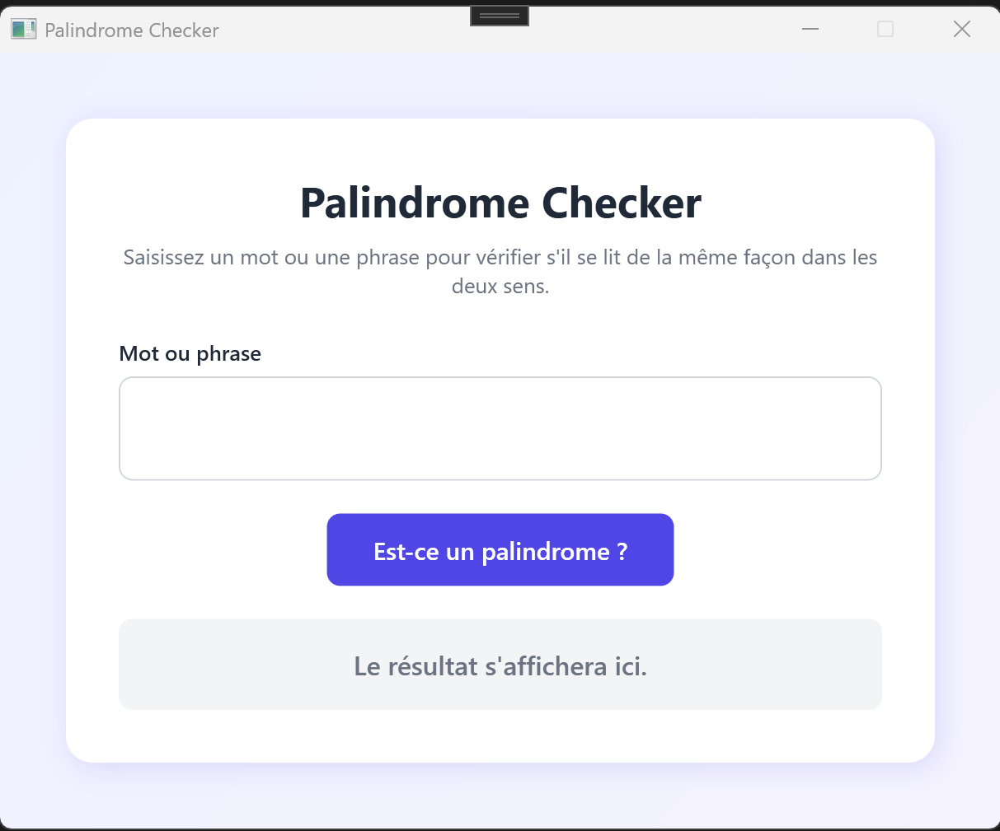

# PalindromeChecker

<!-- Replace with your badge: Azure DevOps → Pipelines → PalindromeChecker → ⋮ → Status badge → copy the Markdown -->
[](https://dev.azure.com/amohsine/PalindromeChecker/_build)

Application desktop **WPF** qui indique si un mot ou une phrase est un **palindrome**, avec un service testé par **xUnit** et un pipeline **CI Azure DevOps**.

Projet réalisé dans le cadre de ma spécialisation Full Stack .NET chez Technofutur TIC.



---

## Fonctionnalités

- Vérifie un **mot** (`kayak` → vrai, `pomme` → faux).
- Vérifie une **phrase** en ignorant :
  - les **majuscules** (`Kayak`),
  - les **espaces** et la **ponctuation** (`Un roc si biscornu.`),
  - les **accents** et la cédille (`Et la marine va, papa, venir à Malte.`).
- Gère les cas limites : texte sans lettre (`"!!!"` → faux), une seule lettre (vrai), `null` (exception).

## Technologies

| Domaine | Outils |
|---|---|
| Langage / framework | C#, **.NET 11** |
| Interface | **WPF** |
| Architecture | Séparation des couches, **injection de dépendances** (`Microsoft.Extensions.DependencyInjection`) |
| Tests | **xUnit** (`[Fact]`, `[Theory]`, structure AAA) |
| CI | **Azure Pipelines** (YAML), Azure Repos, branch policies |

## Architecture

```
PalindromeChecker/
├── azure-pipelines.yml              # CI pipeline
├── src/
│   ├── PalindromeChecker.Core/      # Business logic (no UI dependency)
│   │   ├── IPalindromeService.cs
│   │   └── PalindromeService.cs
│   └── PalindromeChecker.Desktop/   # WPF user interface
└── tests/
    └── PalindromeChecker.Tests/     # xUnit tests for Core
```

| Projet | Rôle | Cible |
|---|---|---|
| `PalindromeChecker.Core` | Contient la logique métier : `IPalindromeService` / `PalindromeService` | `net11.0` |
| `PalindromeChecker.Desktop` | Interface WPF ; reçoit `IPalindromeService` par **injection de dépendances** | `net11.0-windows` |
| `PalindromeChecker.Tests` | Tests unitaires du service | `net11.0` |

**Choix de conception**

- La logique est isolée dans `Core` : elle est **testable sans l'interface graphique** et réutilisable (API, application web…).
- La fenêtre dépend de l'**interface** `IPalindromeService`, pas de l'implémentation ; le service est enregistré dans un conteneur DI au démarrage (`App.xaml.cs`).
- Normalisation du texte : `ToLowerInvariant()` → `Normalize(NormalizationForm.FormD)` (sépare les lettres de leurs accents) → `char.IsLetterOrDigit` (retire accents, espaces et ponctuation) → comparaison des caractères depuis les deux extrémités jusqu'au milieu.

## Lancer le projet

**Prérequis :** Windows, [SDK .NET 11](https://dotnet.microsoft.com/download).

```bash
git clone https://github.com/ahmmohsine/PalindromeChecker.git
cd PalindromeChecker

dotnet build
dotnet run --project src/PalindromeChecker.Desktop
```

Ou ouvrir `PalindromeChecker.slnx` dans Visual Studio et lancer `PalindromeChecker.Desktop` (F5).

## Lancer les tests

```bash
dotnet test
```

Les tests couvrent les mots, les phrases (avec accents et ponctuation), les majuscules, les cas limites et la valeur `null`.

## Intégration continue (Azure Pipelines)

À chaque push sur `main`, le pipeline `azure-pipelines.yml` :

1. installe le SDK .NET 11 sur un agent **Windows** (requis par WPF) ;
2. restaure les paquets NuGet ;
3. compile la solution en **Release** ;
4. **exécute les tests** : un test en échec fait échouer le pipeline ;
5. publie l'application WPF ;
6. met l'application à disposition comme **artifact** téléchargeable.

La branche `main` est protégée par une **branch policy** : toute modification passe par une **Pull Request**, validée automatiquement par ce pipeline (*Build validation*). Un code qui casse les tests ne peut pas être fusionné.

## Pistes d'amélioration

- [ ] Passer l'interface en **MVVM** (`MainViewModel` + data binding).
- [ ] Workflow **GitHub Actions** équivalent au pipeline Azure.
- [ ] Publication *self-contained* (`-r win-x64 --self-contained`) pour un exécutable sans prérequis .NET.

## Auteure

**Ahlame Mohsine** — Développeuse .NET Full Stack
[GitHub](https://github.com/ahmmohsine)
